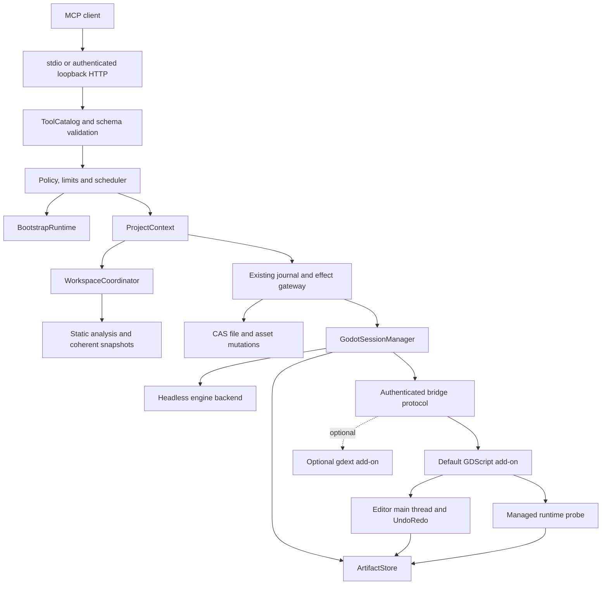

# Complete Godot development implementation plan

> **Status**: Approved design; implemented in milestones M0–M7 · **Date**: 2026-10-08 · **Version**: 1.0
> **Baseline**: the 0.1 tree of 2026-10-08 · **Audience**: Maintainers and implementers

## TL;DR

The version 0.1 safety, analysis and recovery foundations are retained, but the project/runtime
assembly and product surface are reworked around one canonical project context, a live coherent
workspace snapshot, truthful tool discovery, complete authoring primitives and managed Godot
sessions. A pure-GDScript bridge is the default live-editor/runtime backend; a directly reused
`godot-rust/gdext` backend is optional and measurement-gated. Completion is proven by one real MCP
workflow that starts from an empty workspace and ends with tested, observed and exported game
artifacts on every declared desktop platform.

> [!IMPORTANT]
> This page specifies post-0.1 work. It does not claim that the current binary already implements
> the planned methods. Current behavior remains documented in the operator guides until each
> milestone lands with its tests and contract update.

## Contents

- [1. Product objective and scope](#1-product-objective-and-scope)
- [2. Baseline findings](#2-baseline-findings)
- [3. Architectural decisions](#3-architectural-decisions)
- [4. Target architecture](#4-target-architecture)
- [5. Project identity and workspace coherence](#5-project-identity-and-workspace-coherence)
- [6. Public tool and contract design](#6-public-tool-and-contract-design)
- [7. Authoring and mutation model](#7-authoring-and-mutation-model)
- [8. Editor and runtime bridge](#8-editor-and-runtime-bridge)
- [9. Managed Godot sessions and process isolation](#9-managed-godot-sessions-and-process-isolation)
- [10. Artifacts, logs and export](#10-artifacts-logs-and-export)
- [11. Security and recovery invariants](#11-security-and-recovery-invariants)
- [12. Implementation milestones](#12-implementation-milestones)
- [13. End-to-end acceptance matrix](#13-end-to-end-acceptance-matrix)
- [14. Migration and qualification](#14-migration-and-qualification)
- [15. Risks and decision gates](#15-risks-and-decision-gates)
- [16. Definition of done](#16-definition-of-done)

## 1. Product objective and scope

### 1.1 Objective

An MCP client can perform the complete development loop for a standard Godot and GDScript game:

1. Bind or create a project under an explicitly authorized workspace root.
2. Read, create, patch, move and delete source files and assets with conflict preconditions.
3. Create and edit scenes, resources and project settings through typed operations.
4. Use a live editor when available, including selection and one-action undo/redo semantics.
5. Start and stop managed game/editor processes and read bounded logs and diagnostics.
6. Inspect a running scene, send bounded input and capture visual evidence.
7. Run engine checks and committed test frameworks.
8. Validate export presets and produce authorized export artifacts.
9. Recover after server, editor, bridge or child-process interruption without guessing a mutation
   result.

The first complete target covers GDScript-first Godot 4.4.1, 4.5.1, 4.6.1 and 4.7.1 projects on
Linux x86_64, macOS universal and Windows x86_64. The semantic scene/resource model covers ordinary
2D and 3D nodes through typed Godot values rather than one public tool per engine method.

### 1.2 Explicit exclusions for the first complete target

- C# project authoring and .NET build orchestration.
- User-authored native extension compilation.
- Mobile and web export pipelines.
- A general “execute arbitrary GDScript” method.
- Public one-tool-per-Godot-method reflection.
- More than one project bound to one running MCP process.

These are future scope choices, not hidden prerequisites for the GDScript desktop workflow.

### 1.3 Success is a workflow, not a tool count

Success is not the number of entries returned by tool discovery. The qualifying workflow is:

```text
empty authorized workspace
  -> create and bind project
  -> create scripts, assets, scenes and project settings
  -> validate and import
  -> start managed game
  -> inspect state, send input and capture screenshot
  -> stop cleanly and run tests
  -> export a desktop artifact
  -> restart server and verify coherent state
```

Every arrow has a typed response, a bounded deadline, a project/workspace revision and a repeatable
failure test.

## 2. Baseline findings

The findings below were reproduced against that 0.1 baseline; they define the first milestone
rather than being deferred behind feature work.

| ID | Severity | Finding | Required correction |
| --- | --- | --- | --- |
| F-01 | Blocker | State/lock paths are derived from the caller's candidate before canonical root discovery. Root and child launches can both acquire different lock files for one project. | Derive every state owner from one acquired canonical project context. |
| F-02 | Blocker | A relative project path starts the server but the first indexed query is refused because the analysis state path is relative. | Normalize once before any state directory or index is opened. |
| F-03 | Blocker | Inventory and settings are captured once and the first index snapshot is cached indefinitely; a new file remains invisible while the response still reports coherent state. | Install a production workspace coordinator with watcher and commit-driven invalidation. |
| F-04 | Blocker | Authoring cannot create or patch GDScript, project settings or assets; scene/resource write tools only canonicalize an existing target. | Add bounded CAS file operations and a typed scene/resource mutation model. |
| F-05 | Major | The production process provider is a Linux-procfs-dependent weak Unix locator; implemented Windows Job, cgroup and disposable paths are not wired. | Select providers by host and trust posture and qualify each production path. |
| F-06 | Major | A game run is a synchronous invocation rather than a managed session; no public status, stop or log stream exists. | Introduce a durable session manager and opaque run identifiers. |
| F-07 | Major | A nonzero game run omits parsed diagnostics and captured text, while an internal absolute locator is returned publicly. | Separate public/internal proof DTOs and publish bounded output artifacts. |
| F-08 | Major | Editor/runtime methods are advertised although their production handlers are absent. | Make profiles authorization ceilings and discovery reflect implemented handlers. |
| F-09 | Major | No project export operation exists although an export capability is present. | Add preset inspection, validation, asynchronous export and artifact delivery. |
| F-10 | Moderate | Tool name, schema, policy row, handler and docs are maintained in several independent registries. | Generate all surfaces from one typed ToolCatalog. |

### 2.1 Evidence anchors

- F-01/F-02: `ProjectRuntime::open` computes state from the project member of `options` before lease discovery in
  `crates/godot-mcp-server/src/stdio.rs:172-180`, then passes the same candidate to the engine at
  `crates/godot-mcp-server/src/stdio.rs:341-346`. A live smoke started root and child instances
  simultaneously; both initialized and created separate state roots. A relative-path smoke then
  reached the index refusal at `crates/godot-mcp-analysis/src/index/store.rs:139-157`.
- F-03: startup inventory is fixed at `crates/godot-mcp-server/src/stdio.rs:181-207`; the session
  retains one optional snapshot at `crates/godot-mcp-server/src/core/session.rs:133-144` and returns
  it unchanged at `crates/godot-mcp-server/src/core/session.rs:230-244`. The production route also
  reports workspace freshness as unconditionally fresh at
  `crates/godot-mcp-server/src/engine_plane/runtime.rs:89-96`. A live smoke created a new script
  after the first query; the second query still reported the old snapshot as coherent.
- F-04: canonical public arguments expose only target, resource name and dry-run at
  `crates/godot-mcp-server/src/engine_plane/request.rs:102-147`; the canonical target classifier
  excludes scripts, project settings and assets at
  `crates/godot-mcp-engine/src/canonical/request.rs:338-351`.
- F-05: production constructs only `UnixLocatorProvider` at
  `crates/godot-mcp-server/src/engine_plane.rs:194-196`, while non-Linux process observation is
  explicitly unavailable at `crates/godot-mcp-engine/src/supervision/procfs.rs:247-289`. The
  engine binding also fixes trust to trusted at
  `crates/godot-mcp-server/src/engine_plane/runtime.rs:139-157`.
- F-06/F-07: the run handler waits in the request path at
  `crates/godot-mcp-server/src/engine_plane/handler.rs:232-262`; its public projection drops
  captured diagnostics and bytes at `crates/godot-mcp-server/src/engine_plane/process.rs:47-58`.
  Internal boundary identity is a serializable proof field at
  `crates/godot-mcp-server/src/journal/record.rs:224-237`. A nonzero-run smoke returned an internal
  absolute locator and byte counts without the parsed engine error.
- F-08/F-10: tool discovery uses a generic description and manifest membership at
  `crates/godot-mcp-server/src/kernel.rs:454-465`; a handlerless method receives a permissive
  object schema at `crates/godot-mcp-server/src/kernel.rs:1098-1135`. Tool membership is separately
  repeated in `crates/godot-mcp-domain/src/manifests.rs` and policy in
  `crates/godot-mcp-server/src/policy/matrix.rs`.
- F-09: runtime profiles grant the destructive export capability but their manifest method list
  contains no export operation at `crates/godot-mcp-domain/src/manifests.rs:52-77,127-140`.

## 3. Architectural decisions

### 3.1 Preserve

The following foundations remain authoritative unless a failing test proves a local change is
necessary:

- `godot-mcp-domain` value contracts, error taxonomy and handle-safe path authority.
- `SafeRoot` descriptor/handle-relative reads and CAS publication.
- The one durable transaction store, three terminal dispositions and quarantine semantics.
- Effect permits, idempotency identity, audit and bounded scheduler.
- GDScript, project, scene and resource parsers plus incremental index storage.
- Godot executable discovery, exact-version probing and argument-array launching.
- The ten-kind bridge envelope, authenticated rendezvous and mutation replay rules.
- LSP/DAP codecs and owned-endpoint admission logic.

### 3.2 Rewrite in place

| Area | Current problem | New owner |
| --- | --- | --- |
| ProjectRuntime assembly | Candidate spelling escapes into state, lock and engine paths | ProjectContextFactory |
| CoreSession state | Immutable startup inventory and cached snapshot | WorkspaceCoordinator |
| Tool registries | Membership, policy, schema and handler drift | ToolCatalog |
| Process boundary selection | One Linux-specific production provider | BoundaryProviderRegistry |
| One-shot run path | No long-lived process ownership API | GodotSessionManager |
| In-memory artifact map | Startup-only mutation API, no producer path | ArtifactStore |
| Public process proof | Internal locator serialized to clients | PublicExecutionProof projection |

### 3.3 Add

- Bootstrap runtime state for project creation before a project identity exists.
- Bounded source/asset file mutations over the existing effect gateway.
- Semantic batch mutations for scene/resource/project settings.
- Default GDScript EditorPlugin and runtime probe.
- Typed reflection/Variant catalogue.
- Managed editor, game, test, import and export sessions.
- Dynamic artifact registration with private disk backing and retention.
- Real cross-version and cross-platform workflow fixtures.

## 4. Target architecture



| Component | Responsibility | Must not own |
| --- | --- | --- |
| BootstrapRuntime | Create or bind exactly one project under an explicit workspace authority | Project mutations after binding |
| ProjectContext | Canonical root, held lease, project identity, private state root | Mutable analysis details |
| WorkspaceCoordinator | Inventory, settings, watcher, revision and atomic snapshots | Effect authorization |
| ToolCatalog | Names, descriptions, schemas, annotations, capability and handler key | Environment availability guesses |
| MutationService | Preconditions, preview, transaction and publish | A second journal |
| GodotSessionManager | Durable lifecycle for editor/game/import/test/export sessions | Raw PID authority from callers |
| BridgeHost | Rendezvous, capability negotiation, request correlation and heartbeat | MCP or policy decisions |
| ArtifactStore | Private bytes, metadata, range reads, expiry and authorization | Public filesystem locations |

## 5. Project identity and workspace coherence

### 5.1 Canonical acquisition sequence

One function owns the complete acquisition sequence:

```rust
pub struct ProjectContext {
    lease: Lease,
    display_root: PathBuf,
    state_root: PathBuf,
    identity: ProjectIdentity,
}
```

The factory performs these steps in order:

1. Resolve the nearest `project.godot` from the supplied candidate and obtain an absolute normalized
   display root.
2. Open and validate root/project handles without following disallowed path components.
3. Derive the stable object key.
4. Derive exactly one private state root from the acquired project root or a per-user directory
   keyed by that stable object key.
5. Acquire the cross-process lock in that unique state root.
6. Revalidate the discovered path against the held handles.
7. Construct journal, audit, index, provider registry and engine bindings only from ProjectContext.

After step 7, the original candidate spelling is dropped. No later component receives it.

Required tests start servers through an absolute root, a relative root, nested directories,
lexical aliases and supported same-object aliases. Every spelling must converge on the same lock;
a second server must be refused before journal or mutation initialization.

### 5.2 Bootstrap state

A server launched with an explicit workspace authority starts in one of two states:

```text
Bootstrap(workspace authority) -> ProjectBound(project context) -> Closed
```

Bootstrap exposes only health, capabilities, project discovery, project creation and one-time
binding. Project creation accepts a relative directory under the held workspace root. After a
successful bind, the server emits a tool-list-changed notification and can never bind a second
project during that process lifetime.

The bootstrap authority is separate from project authority. A project transaction cannot be
replayed in bootstrap state, and bootstrap creation cannot escape or replace an existing project.

### 5.3 Atomic workspace snapshot

```rust
pub struct WorkspaceSnapshot {
    revision: u64,
    inventory_digest: String,
    settings_digest: String,
    index: Arc<IndexSnapshot>,
}
```

WorkspaceCoordinator owns the current snapshot behind a short lock. A request clones one snapshot
and uses it for its complete answer; it does not combine a live file read with an older semantic
graph.

A revision advances after any of:

- a committed MCP file/editor mutation;
- a debounced external create, modify, rename or remove event;
- a watcher overflow followed by a successful full rescan;
- a project settings or imported-resource state transition that changes source-visible facts.

Watcher overflow never emits a partial revision. If a refresh fails, the previous snapshot remains
readable but is explicitly stale, and mutation admission is blocked when its preconditions cannot
be proven.

### 5.4 Mutation-to-read barrier

A successful mutation response is not returned until:

1. its terminal transaction state is durable;
2. WorkspaceCoordinator has observed the exact touched paths;
3. a new coherent snapshot is published; and
4. the response carries the new revision and affected content digests.

This establishes read-your-writes behavior for one MCP session without relying on filesystem event
timing.

## 6. Public tool and contract design

### 6.1 Contract version

The implementation introduces domain contract 0.2.0 because tool discovery semantics and several
DTOs change. Version 0.1 journal records remain readable for reconciliation; they are not rewritten
in place.

Profiles continue to grant capabilities, but profile membership does not manufacture a handler.
Tool discovery is the intersection of:

```text
selected profile authorization
AND compiled implementation
AND valid method schema
```

Temporary environmental unavailability is returned by an implemented tool with a structured
reason. An absent implementation is not listed.

### 6.2 One ToolCatalog

Every public method is one static descriptor:

```rust
pub struct ToolDescriptor {
    name: &'static str,
    summary: &'static str,
    capability: Capability,
    plane: OperationPlane,
    family: Option<OperationFamily>,
    annotations: ToolAnnotations,
    schema: fn() -> RootSchema,
    handler: HandlerKey,
    introduced_in: ContractVersion,
}
```

The profile manifest, policy matrix, tools/list response, argument validator, handler completeness
test and generated documentation are derived from this catalogue. Compilation or a deterministic
test fails when a descriptor has no schema/handler or a handler has no descriptor.

Annotations declare read-only, destructive, idempotent and open-world behavior. Descriptions state
preconditions, revision behavior and whether the operation needs an editor, a game session or only
the headless engine.

### 6.3 Planned surface by milestone

Names below are design targets. They enter discovery only when their milestone is implemented.

| Family | Methods | Purpose |
| --- | --- | --- |
| Bootstrap | project.create, project.bind | Create/bind the process's one project |
| Coherent files | project.files.list, file.get, file.create, file.patch, file.move, file.delete | Safe source and asset CRUD with SHA preconditions |
| GDScript | script.create, script.patch, script.check | Author and validate scripts without an arbitrary execution method |
| Project settings | project.settings.get, project.settings.patch | Typed main scene, autoload, input and selected project settings |
| Scenes | scene.create, scene.batch.apply, scene.tree.get | Atomic semantic scene operations and reads |
| Resources | resource.create, resource.batch.apply, resource.tree.get | Typed resources and dependency-safe edits |
| Assets | asset.put, asset.import, asset.status, asset.delete | Bounded content ingest and engine import |
| Editor | editor.state.get, editor.selection.get, node.batch.apply | Live reads and one UndoRedo action per batch |
| Managed run | project.run.start, project.run.status, project.run.logs, project.run.stop | Long-lived owned game lifecycle |
| Runtime | runtime.tree.get, runtime.properties.get, runtime.signals.get, runtime.ui.get | Bounded live inspection |
| Input | input.action.send, input.key.send, input.mouse.send, input.sequence.send | Session-scoped synthetic input with automatic release |
| Capture | runtime.screenshot.capture, runtime.recording.capture | Opaque visual artifacts |
| Tests/debug | project.test, debug.session.get, debug.command | Test verdicts and receipt-bound LSP/DAP commands |
| Export | export.presets.list, project.export, project.export.status, project.export.cancel | Validated export and artifact delivery |

Generic file mutations use an extension/content policy. Text sources include GDScript, shaders and
ordinary project data. Godot scenes/resources use semantic tools when the operation needs engine
canonicalization. Generated `.godot` cache paths remain outside public file authority.

### 6.4 Shared mutation envelope

Every state-changing method uses a common envelope conceptually equivalent to:

```json
{
  "idempotencyId": "client-operation-id",
  "expectedRevision": 42,
  "preconditions": [
    {"path": "scripts/player.gd", "sha256": "<64 lowercase hex>"}
  ],
  "dryRun": false,
  "operations": []
}
```

Rules:

- `idempotencyId` is required for public mutation methods.
- `expectedRevision` protects multi-file semantic assumptions.
- Every replaced/deleted file also has a content precondition.
- Create requires absence; move requires source identity and destination absence.
- Dry run performs schema, policy, type, target and conflict checks and returns a bounded diff, but
  cannot obtain a publisher permit.
- One batch has one transaction identity and one terminal outcome.
- Unknown operation fields are rejected.

## 7. Authoring and mutation model

### 7.1 File and script operations

File operations reuse SafeRoot and the existing file-effect journal. Patch input is structured as
whole replacement, unified patch with expected hash, or bounded line edits. The server applies a
patch in memory, validates UTF-8 and size, computes the intended hash, stages it and publishes with
CAS.

Script authoring never implies execution. Static parse runs before publish by default; callers may
explicitly allow a syntactically damaged intermediate file, but the result records diagnostics and
cannot be confused with an engine-backed pass. Engine checking remains a separate operation.

### 7.2 Project settings

Project settings are changed through typed operations, not raw substring edits:

- set/clear main scene;
- add/update/remove autoload;
- add/update/remove input action;
- set an allowlisted scalar/project value;
- enable/disable an installed add-on.

The implementation preserves unrelated keys and comments where possible, validates the resulting
manifest, stages bytes, applies CAS and reloads ProjectSettings into the next workspace revision.
Sensitive export values are never returned unredacted.

### 7.3 Scene and resource command model

One backend-neutral command model covers both headless and live-editor execution:

- create, delete, duplicate, rename and reparent nodes;
- set or clear typed properties;
- attach/detach a script;
- instantiate or replace a child scene;
- connect/disconnect signals;
- add/remove groups;
- create/update sub-resources and external resource references;
- save as a new text scene/resource or update an existing one.

Node handles contain scene identity, node path and workspace revision. A stale handle returns a
conflict instead of targeting a similarly named replacement.

### 7.4 Backend selection

| Condition | Backend | Commit semantics |
| --- | --- | --- |
| No live editor and operation is batch-safe | Headless helper | Stage canonical bytes, CAS publish, refresh snapshot |
| Live editor with no unsaved conflict | GDScript editor bridge | One named EditorUndoRedoManager action, save, observe and refresh |
| Live editor has a divergent buffer | Editor bridge only | Apply against editor state or refuse; never overwrite from headless path |
| Backend cannot represent requested value | None | Return unsupported before transaction effect starts |

Backend choice does not change the MCP request or result schema.

## 8. Editor and runtime bridge

### 8.1 Default add-on layout

```text
addons/godot_mcp/
  plugin.cfg
  plugin.gd
  bridge_client.gd
  command_queue.gd
  type_catalog.gd
  variant_codec.gd
  editor_handlers.gd
  mutation_handlers.gd
  runtime_controller.gd
  runtime_probe.gd
  status_dock.gd
```

The add-on is installed with content ownership metadata. Update backs up divergent user edits;
remove deletes only owned bytes.

### 8.2 Main-thread dispatcher

Networking only parses bounded frames and queues validated envelopes. A deferred main-thread drain:

1. rechecks deadline, cancellation and project identity;
2. validates method capability and typed arguments;
3. resolves revision-bound handles;
4. executes the read or builds one UndoRedo mutation action;
5. observes the result and dirty/save state; and
6. returns a typed payload with committed, not-started or unresolved mutation status.

Disconnect never turns unresolved into retryable. Heartbeat expiry cancels queued reads, leaves an
executing mutation to report/reconcile and releases all held synthetic input.

### 8.3 Type catalogue and Variant codec

The Rust catalogue merges:

- exact-version API metadata;
- runtime ClassDB/property/method/signal/enum snapshots;
- project GDScript classes and symbols; and
- bridge capabilities for the active Godot build.

The tagged codec covers null, booleans, integer/floating values, strings, StringName, NodePath,
vectors, transforms, rectangles, planes, quaternions, Color, arrays, dictionaries, enums,
bitfields, resource references and revision-bound object/node handles. Depth, collection length and
serialized bytes are bounded. Arbitrary object internals are never serialized.

### 8.4 Optional gdext backend

The optional backend follows [ADR 0010](adr/0010-complete-development-bridge-strategy.md). It is not
a reason to delay the default add-on. A non-shipping spike first runs the same bridge conformance
suite against exact Godot builds and records latency, memory, artifact size, load/unload behavior
and editor crash outcomes.

If activated, it directly consumes the upstream binding instead of recreating GDExtension FFI. It
uses the same method schemas and cannot add a native-only MCP affordance.

## 9. Managed Godot sessions and process isolation

### 9.1 Durable session model

Game, editor, import, test and export processes use opaque session IDs. A session record contains
project identity/revision, process transaction, boundary kind, engine digest/version, argv digest,
state, timestamps and output artifact IDs. Raw PIDs and boundary locators remain internal.

```text
planned -> starting -> running -> stopping -> exited
                    \-> failed
                    \-> unresolved -> reconciled or quarantined
```

Start returns after the boundary, process identity and bridge/rendezvous readiness are durably
proven. It does not wait for a normal game to exit. Status and logs are independent bounded reads.
Stop accepts only an owned session ID and derives the recorded process/boundary identity internally.

### 9.2 Provider registry

BoundaryProviderRegistry orders available providers according to host and requested trust:

- Windows: Job Object provider for managed processes.
- Linux: configured container adapter or delegated cgroup v2; trusted mode may use the documented
  weak locator when explicitly permitted.
- macOS: a native observable provider must be implemented and qualified, or a configured strong
  external provider is required. The runtime plane is not advertised as available before that.

Untrusted mode selects only a provider whose observed limits prove the required strength. Trusted
fallback is never silently used for an untrusted request. Startup reconciliation receives every
provider kind that may have created a durable record, so a provider change cannot orphan an older
session.

### 9.3 Runtime probe

A managed game gets a session-scoped runtime probe through an engine-supported debug channel or a
transactionally installed temporary autoload. The original project settings preimage is durable
before installation and restored on clean stop or startup reconciliation. An uncertain restoration
blocks further mutations.

The probe publishes heartbeat, scene-tree/property/signal/UI snapshots, engine diagnostics and
capture readiness. Synthetic input belongs to one session and is released on stop, cancellation,
bridge loss or local heartbeat expiry even if the Rust process is gone.

### 9.4 LSP and DAP

The existing codecs are wired only to endpoints from a server-owned editor launch receipt. The
manager allocates explicit ports, records them with binary/root identity and verifies them before
connect and reconnect. Planned debug commands cover diagnostics, document symbols, breakpoints,
stack, scopes, variables, pause, continue and stop; unrestricted expression evaluation is not part
of the first complete target.

## 10. Artifacts, logs and export

### 10.1 ArtifactStore

ArtifactStore is an interior-mutable service shared by handlers and transports. Bytes live under a
private state directory; public results contain only opaque artifact URIs and metadata.

Required properties:

- atomic registration after producer close and SHA-256 verification;
- project, principal and session binding;
- media type, length, dimensions/duration where applicable;
- expiry and total-byte accounting;
- bounded range reads over both transports;
- startup removal of expired terminal artifacts and preservation of unresolved evidence;
- no raw path in result, error, log, audit or health output.

### 10.2 Logs and diagnostics

Process stdout/stderr are retained up to configured caps and exposed as text pages or artifacts.
Every run result includes classification, exit/signal/timeout facts, normalized engine diagnostics,
truncation flags and artifact references. A nonzero engine exit is a completed MCP call with a
failed domain classification, never a content-free success.

### 10.3 Capture

Screenshot capture waits for a frame boundary, validates selected viewport/camera ownership and
publishes PNG bytes through ArtifactStore. Recording has explicit duration, FPS, resolution, frame
and byte limits. Partial media is removed on clean cancellation or retained only as private
recovery evidence when disposition is unresolved.

### 10.4 Export

The export service:

1. lists preset names and non-sensitive capabilities;
2. validates engine/editor build, export template availability and output policy;
3. refuses or redacts sensitive preset fields;
4. launches an asynchronous supervised export using an argument array;
5. captures diagnostics and progress;
6. hashes and registers every output artifact; and
7. optionally smoke-runs an export where the platform permits.

Export output cannot overwrite project source by default. A replacement requires an exact artifact
precondition and the destructive export capability.

## 11. Security and recovery invariants

These invariants are release blockers:

1. One stable project object has one lock, journal, scheduler and workspace revision source.
2. All filesystem effects are held-root-relative and have create-absence or content-hash
   preconditions.
3. Every effect is authorized before queue admission and rechecked at its final boundary.
4. No public tool grants arbitrary editor/runtime method invocation or arbitrary script execution.
5. A bridge is authenticated by launch/project facts and a fresh secret, not by loopback location.
6. Godot editor calls execute on the main thread only.
7. A live editor buffer is never overwritten by a headless writer.
8. Only not-started mutations are automatically replayable; unresolved mutations quarantine.
9. Public execution proof is a redacted projection and contains no locator or local storage path.
10. Untrusted process execution requires a proven strong provider.
11. Synthetic input is scoped, bounded and released without depending solely on server cleanup.
12. Capture, logs and exports are authorized opaque artifacts with retention limits.
13. Version 0.1 open transactions are reconciled before a 0.2 mutation is admitted.
14. Tool discovery cannot advertise a method without a schema and production handler.

## 12. Implementation milestones

Each milestone uses TDD: add the named behavioral failure, confirm the failure reason, implement the
smallest complete slice, then refactor while the test stays green. Milestone 0 is serial and blocks
all other mutation work.

### M0 — Correctness hotfix

**Scope**

- Introduce ProjectContextFactory and remove candidate-derived runtime state.
- Converge root/subdirectory/relative aliases on one lease and state root.
- Replace public process proof with a redacted DTO.
- Return run classification, diagnostics and bounded output references.

**Primary files**

- `crates/godot-mcp-server/src/stdio.rs`
- `crates/godot-mcp-server/src/engine_plane/runtime.rs`
- `crates/godot-mcp-server/src/engine_plane/process.rs`
- `crates/godot-mcp-domain/src/lease.rs`

**Acceptance**

- A second server through any spelling of the same project returns conflict.
- Relative project paths serve indexed core calls.
- Godot receives the discovered root in every argument array.
- Serialized MCP responses contain no state-root or locator path.
- Nonzero run fixture returns failed classification and its parsed diagnostic.

### M1 — Coherent workspace and ToolCatalog

**Scope**

- Add WorkspaceCoordinator and wire the existing incremental index algorithms.
- Refresh inventory/settings/index after watcher batches and committed effects.
- Add workspace revision to static/mutation results.
- Replace parallel tool registries with ToolCatalog.
- Bump the domain contract to 0.2.0 and make discovery implementation-backed.

**Acceptance**

- Create/modify/rename/delete after first query appears in the next coherent snapshot.
- Mutation response revision is immediately readable.
- Overflow performs one full rescan or reports stale without claiming coherence.
- Every discovered tool has one strict schema, handler, policy row and useful description.

### M2 — Bootstrap, source, settings and assets

**Scope**

- Add explicit workspace bootstrap state and one-time project bind.
- Add file/script CRUD with hash preconditions and bounded diffs.
- Add typed project settings operations.
- Add small inline asset upload and a bounded large-asset staging path.
- Run import and surface normalized diagnostics/artifact status.

**Acceptance**

- A clean workspace becomes a valid bound project entirely through MCP.
- A script can be created, patched, statically validated and engine checked.
- Main scene, autoload and input actions survive reload.
- Binary asset hash before/after import is observable without exposing a local path.

### M3 — Semantic scene/resource authoring

**Scope**

- Define batch command DTOs and tagged Variant values.
- Extend the canonical helper to create and mutate complete scene/resource graphs.
- Enforce revision-bound handles, node ownership, resource references and CAS publication.
- Make one backend-neutral result/diff format.

**Acceptance**

- Create a 2D and a 3D scene, attach scripts/resources, connect signals and persist groups.
- Reload through Godot and static parser yields the intended semantic tree.
- Stale handles and external changes refuse without publishing bytes.
- Kill at each durable phase resolves to pre-state, post-state or quarantine.

### M4 — Default GDScript editor bridge

**Scope**

- Ship and lifecycle-manage the add-on described in section 8.
- Implement TypeCatalog and Variant codec goldens.
- Wire editor state/selection and semantic mutations through one UndoRedo action.
- Handle open dirty buffers, plugin disable/reload and reconnect.

**Acceptance**

- Exact-version editor tests enable, reload and disable the add-on without residue.
- Reads do not dirty a scene or add undo history.
- Each mutation saves/reloads, undoes to the semantic pre-state and redoes to post-state.
- Off-main-thread test fixture is refused.
- Disconnect during mutation never becomes an automatic replay.

### M5 — Managed runtime, input, capture and debug

**Scope**

- Add GodotSessionManager start/status/logs/stop.
- Add runtime probe lifecycle and heartbeat restoration.
- Implement runtime inspection, bounded input and visual capture.
- Connect the existing LSP/DAP adapters to owned editor sessions.

**Acceptance**

- Start returns a running session rather than waiting for game exit.
- Runtime tree/property/signal/UI changes are observable with revision/session identity.
- Key, mouse and action state is released on every stop/cancel/disconnect/expiry path.
- Screenshot dimensions/hash are deterministic for the fixture.
- Breakpoint, stack and variable reads come only from the owned editor receipt.

### M6 — Export and artifact lifecycle

**Scope**

- Implement ArtifactStore and migrate existing artifact tests to its production API.
- Add preset inspection, export start/status/cancel and output smoke checks.
- Bind output to project/principal/session and retention.

**Acceptance**

- A fixture exports through an exact installed template and yields a hash-verified artifact.
- Missing template, secret-bearing preset, oversize output and cancellation fail safely.
- Artifact range authorization matches over stdio and authenticated HTTP.
- Expired artifacts disappear while unresolved recovery evidence remains private.

### M7 — Cross-platform completion and optional gdext decision

**Scope**

- Wire Windows Job Object, Linux strong providers and a qualified macOS path.
- Run the complete workflow on all declared desktop targets.
- Execute the isolated gdext spike and apply ADR 0010 activation criteria.
- Replace first-release absence-based qualification rules with 0.2 capability evidence.

**Acceptance**

- No required process/editor/runtime/export check is skipped or relabelled.
- The complete game fixture passes against each exact Godot version on Linux and release smoke on
  macOS/Windows.
- Optional gdext remains absent unless its benchmark and live-load evidence pass.
- Default package remains usable without the native backend.

### 12.1 Dependency order

```text
M0 -> M1 -> M2 -> M3 -> M4 -> M5 -> M6 -> M7
                 \-----------> M6
M1 -> isolated gdext spike -----------------> M7 decision
```

M6 ArtifactStore implementation can begin after M1, but export qualification waits for M2/M3
project authoring. The gdext spike can run after ToolCatalog/bridge schemas stabilize and cannot
block the GDScript path.

## 13. End-to-end acceptance matrix

| Gate | Fixture action | Required evidence |
| --- | --- | --- |
| Project bootstrap | Create project under empty authorized workspace and bind once | Project object identity, unique state root, revision 1 |
| Source authoring | Create and patch player/controller scripts | Expected/new SHA, parser diagnostics, engine check verdict |
| Scene authoring | Create main, UI and representative 3D scene | Semantic tree, ownership, signals, resource dependencies |
| Settings | Set main scene, input action and autoload | Reloaded settings in same/new session |
| Assets/import | Upload PNG/audio fixture and import | Source hash, imported status, engine diagnostics |
| Editor | Open project, select node, mutate property, undo and redo | Editor receipt, main-thread proof, pre/post semantic digest |
| Runtime | Start game and wait for probe readiness | Opaque session ID, heartbeat, running state |
| Input | Send action/key/mouse sequence | Observed game-state change and automatic release |
| Inspection | Read runtime tree, UI, properties and signals | Bounded typed snapshot tied to session |
| Capture | Capture known frame | Authorized PNG artifact, dimensions, byte length and SHA |
| Debug | Hit fixture breakpoint and inspect locals | Owned DAP receipt, stack/scopes/variables |
| Test | Run committed framework and smoke scene | Parsed summary, zero failures, captured diagnostics |
| Export | Validate preset and export desktop build | Template identity, process proof, artifact SHA and smoke result |
| Recovery | Interrupt server/editor/game at durable phases | Proven pre-state, post-state or blocking quarantine |
| Coherence | Restart and re-read all files | Same project identity, latest revision/digests, no stale-coherent claim |

A release is incomplete if any required row is unavailable on a platform it claims for that row.
Static-only platform packaging may still exist, but its capability report and release notes must
state that narrower surface.

## 14. Migration and qualification

### 14.1 Preserve historical evidence

The original `.omo` plan, cancelled first-release tasks 20–25 and their receipts remain historical.
They are not edited to look completed. Post-0.1 implementation receives a new plan identity, new
active task descriptors and new evidence paths.

### 14.2 Required gate changes

Before M4 can qualify, update or version these first-release guards:

- release-graph rules that prohibit every add-on descriptor rather than only an unapproved native
  default artifact;
- code-quality checks that prove the cancelled plane is absent;
- scope checks that treat a real editor/runtime implementation as first-release scope creep;
- required documentation statements that pin “not shipped” for version 0.1;
- package self-check expectations so the default GDScript add-on is required;
- capability fixtures so planned methods cannot be accepted without production handlers.

The default server dependency graph can continue to deny crate `godot`. If the optional native
package is activated, it uses a separate package policy that allows only the exact approved gdext
family and MPL-2.0 obligations without widening the core policy.

### 14.3 Journal and state compatibility

On first 0.2 startup:

1. acquire the corrected unique project lock;
2. inspect all discoverable legacy candidate state roots before mutation admission;
3. refuse and require operator resolution if more than one contains live/open records;
4. reconcile valid version 0.1 records with their original schema;
5. atomically record the selected state-root migration; and
6. publish the first 0.2 WorkspaceSnapshot only after reconciliation succeeds.

This migration is essential because F-01 may already have produced split state directories.
Silently choosing one could discard the only record of an unresolved effect.

### 14.4 Documentation transition

Operator pages describe current released behavior, not future design. A milestone changes those
pages only when its shipping implementation and qualification evidence exist. This plan and ADR
0010 are the authoritative future direction during implementation.

## 15. Risks and decision gates

| Risk | Early signal | Mitigation / gate |
| --- | --- | --- |
| Split legacy state | Multiple `.godot-mcp` directories for one project object | M0 migration inventory; block writes until reconciled |
| Editor API drift | Exact-version bridge golden differs | Per-version capability shim; no version-string assumptions |
| GDScript bridge latency | Main-thread drain misses benchmark | Batch, paginate and profile; gdext only after ADR activation evidence |
| Native backend complexity | Package/sign/load matrix grows | Keep separate and default-off; same conformance suite |
| Dirty editor conflict | Disk hash differs from editor buffer | Route through editor or refuse; never headless overwrite |
| Runtime probe residue | Autoload/settings remain after stop | Durable preimage and startup reconciliation gate |
| Artifact growth | Capture/export exceeds limits | Reservation before publish, quotas, expiry and cancellation |
| Tool-surface sprawl | One-off engine methods appear publicly | Semantic batch DTOs and ToolCatalog review |
| Contract migration drift | 0.1 client interprets 0.2 DTO | Explicit contract version and generated migration notes |
| Platform overclaim | Package builds but managed run cannot start | Real process/editor/runtime smoke per claimed platform |

## 16. Definition of done

The post-0.1 objective is complete only when all statements below are true:

- The root/subdirectory/relative-path dual-owner reproductions fail safely.
- Every request reads one coherent snapshot and every committed mutation is immediately readable.
- An empty authorized workspace can become a runnable Godot project through MCP alone.
- Scripts, settings, assets, scenes and resources have safe create/update/delete workflows.
- The default GDScript add-on provides real editor UndoRedo and runtime services.
- Managed runs expose status, logs, stop, inspection, input and screenshot evidence.
- Tests and engine diagnostics are parsed into domain verdicts.
- Desktop export produces authorized, hash-verified artifacts.
- Linux, macOS and Windows expose only capabilities proven by real entry tests.
- Server/editor/game interruptions settle to proven pre-state, proven post-state or quarantine.
- No public response leaks a project path, state path, boundary locator, credential or media path.
- Tool discovery contains no handlerless method and every discovered schema rejects unknown fields.
- The full acceptance matrix is bound to the exact source tree, binaries, Godot builds and package
  digests used for the release.
